# CodeReview Agent

A code review engine and CLI for Python and TypeScript repositories, implemented in Python. The same engine reviews GitHub pull requests and local changes through OpenRouter. A capable coordinator delegates bounded tasks to smaller workers; an independent worker verifies source evidence before findings appear.

The reviewer prioritizes maintainability: overloaded files, mixed responsibilities, complexity, simpler alternatives, suitable libraries, and comments explaining non-obvious intent. It also checks correctness, security, regressions, and framework behavior. Small improvements remain visible as suggestions. Version 0.2 adds TypeScript-specific guidance and context for imports and project configuration, including TSX, React, Next.js, and Prisma. Java-specific support is deferred. See the [changelog](CHANGELOG.md).

## Install and configure

Requires Python 3.11+, Git, and [uv](https://docs.astral.sh/uv/). Docker is required for isolated fix validation; reviews do not execute repository code.

```sh
uv sync --locked
uv run codereview --help
uv run codereview --version
```

For use outside this checkout, install the CLI with `uv tool install /absolute/path/to/CodeReview`. Then use `codereview` directly in your target repository.

```sh
codereview init --root /path/to/repository \
  --coordinator-model YOUR_COORDINATOR_MODEL_ID \
  --worker-model YOUR_WORKER_MODEL_ID \
  --provider YOUR_ALLOWED_PROVIDER_SLUG
codereview doctor --root /path/to/repository
```

Choose OpenRouter model IDs advertising **tools** and **structured_outputs**. Set an explicit nonempty model and upstream-provider allowlist in `.codereview.toml`; `--provider` can be repeated. No models are silently chosen for you. Routing fallbacks outside the allowlist are disabled, and unsupported or unknown model pricing fails before generation.

Provide two distinct credentials through your shell or secret manager:

- `OPENROUTER_COORDINATOR_KEY`: the **same dedicated key everywhere**, configured in OpenRouter with a monthly limit of $100 or less, monthly reset, and BYOK usage included in the limit.
- `OPENROUTER_WORKER_KEY`: a separate key for specialist analysis, verification, and repairs. Its provider/account limit is an additional backstop to per-run admission controls.

Do not put credentials in repository configuration. The CLI checks coordinator key settings and catalog pricing before generation. `doctor` checks local setup without making model calls. Relevant private source is sent to OpenRouter and the allowed upstream providers during online runs.

## Local workflow

```sh
codereview review                         # staged, unstaged, nonignored untracked changes
codereview review --staged                # index only
codereview review --base origin/main      # merge-base to current HEAD
codereview audit                          # whole captured repository
codereview review --offline               # scope inspection only; no model calls
codereview review --json --output review.json
codereview runs
codereview show RUN_ID
codereview fix RUN_ID FINDING_ID_1 FINDING_ID_2
codereview fix RUN_ID --all                # explicitly select every finding
```

Run `review` or `audit` first and use the reported run and finding IDs. Finding IDs bind to the exact snapshot; changing source or trusted policy requires a fresh review before fixing. `--root` selects the repository. Run records default to the Git common directory's `codereview/` subdirectory, outside the captured source. `--state-dir` overrides it. These records contain private source and diagnostic output; treat them accordingly.

Review exit codes are `0` for complete coverage and `2` for partial/failed coverage; findings themselves do not set a failure code. Offline scope inspection intentionally returns `2`. Fixes return `0` when validated and `2` for drafts or failures. Configuration/usage errors return a nonzero error code.

### Reviewing TypeScript

Use the same commands in a TypeScript Git repository; no language flag or Python application code is required. `.ts`, `.tsx`, `.mts`, `.cts`, and declaration files are captured automatically, along with JavaScript and relevant project configuration. Python runs the reviewer; Node.js is only needed in your own development tools or optional fix-validation image.

```sh
codereview review --root /path/to/typescript-project --offline
codereview review --root /path/to/typescript-project --staged
codereview review --root /path/to/typescript-project --base origin/main
codereview audit --root /path/to/typescript-project
```

Initialize model/provider settings and supply the two OpenRouter keys before the online commands. Reviews inspect source and configuration without installing packages or running `tsc`, npm scripts, or application code. See the [TypeScript guide](docs/typescript.md) for context coverage, limitations, and isolated type-check setup.

### Requested fixes

Requested repairs create a separate branch and worktree; the original checkout and index remain untouched. Dirty local changes are captured in a synthetic baseline commit, followed by an **agent-only fix commit**. Inspect the printed worktree and commit before cherry-picking or merging. Never push the synthetic local baseline as a fix. The tool retains worktrees for inspection; remove an unwanted one with `git worktree remove PATH` once you have finished with it.

Repairs can add suitable libraries without a second approval. Manifests and lockfiles remain visible in the patch. Missing lock updates, unsupported requests, and incomplete validation are reported; a draft is never presented as validated. The agent never merges.

## Validation

Configure checks in the target repository's trusted `.codereview.toml`. Each command is an argument array, executed inside Docker with no network, no controller keys, no Git metadata, and a fresh disposable source copy. There is no host execution fallback. The image must already contain your toolchain and dependencies, and should be pinned by digest. Prepare and install it using your normal trusted build process before running repairs.

```toml
[[checks]]
name = "python-tests"
image = "your-registry/project-checks@sha256:REPLACE_WITH_DIGEST"
command = ["python", "-m", "pytest", "-q", "-p", "no:cacheprovider"]
timeout_seconds = 120

# Add your repository's lint, type, and application tests as further checks.
# For Node images, put dependencies/tooling outside the /workspace source mount
# and configure commands so TypeScript, Next.js, and Prisma can resolve them.
```

Checks run against the original snapshot and the proposed patch. Reports compare results and include bounded failure diagnostics. A fix is validated only when the independent repair assessment accepts it, the baseline checks complete, and **every configured fixed-code check passes**. Baseline failures remain explicit; unavailable images/tools, missing baseline checks, timeouts, failed fixed-code checks, or incomplete assessments leave a draft. Dependency changes may require a newly prepared validation image before they can be validated. Images are not automatically built from PR-supplied Dockerfiles.

## GitHub Actions

The supplied workflows use trusted controller code separately from the reviewed checkout. Configuration is read from the PR's base revision, so a PR cannot expand its own privileges or spending allowance. Review source is read as data; only Docker validation executes target code.

Setup instructions and exact repository variables are in [docs/github.md](docs/github.md). Commit trusted configuration and workflows to the target's default/base branch, configure the two OpenRouter secrets, and enable Actions' pull-request creation permissions for requested fixes.

- Same-repository PRs are reviewed on opening, updates, reopening, and readiness.
- Fork PRs require a repository writer to apply the `codereview` label. Fork fixes are unavailable in v1.
- Each PR gets one updated summary and selected inline comments. Oversized summaries point to the full run artifact.
- Repository writers can comment `/review fix F... F...` or `/review fix-all`. A successful request creates a separate branch and **draft fix PR targeting the original PR's source branch**.
- Fix requests resolve current findings from a successful trusted review workflow artifact. Stale revisions, altered configuration, expired/missing artifacts, unauthorized requests, and ambiguous publication are rejected.

Use a suitable GitHub App installation token through `CODE_REVIEW_APP_TOKEN` when fix branches should trigger downstream workflows. GitHub suppresses most recursive workflow triggers for writes made with the default `GITHUB_TOKEN`. An App token must have access only to the intended repositories with the required contents and pull-request permissions.

## Spending and time

| Operation | Worker allowance | Total operation deadline |
|---|---:|---:|
| Change review | $2 | 10 minutes |
| Repository audit | $10 | 30 minutes |
| Requested fix, including validation | $5 | 20 minutes |

Coordinator calls share the dedicated key's $100 monthly allowance across all local/GitHub operations. These are configurable ceilings and targets, **not measured quality, cost, or latency guarantees**. Runner and infrastructure costs are separate.

Each model attempt reserves conservative cost before dispatch. Concurrent calls and retries count; usage is settled against provider-reported charges. Unknown charges retain their reservation and appear in the report. Budget exhaustion and deadlines stop new paid work and produce partial results. Provider caps and cancellation cannot guarantee zero overshoot from requests already in flight. Sharing the dedicated key provides the remote monthly backstop; a run-local ledger alone cannot coordinate separate machines.

## Architecture and scope limits

```mermaid
flowchart LR
    I[CLI or GitHub event] --> S[Immutable source snapshot]
    S --> P[Coordinator task plan]
    P --> W[Parallel specialist workers]
    W --> V[Evidence checks and independent verification]
    V --> C[Coordinator ordering]
    C --> R[Findings, coverage, and usage report]
    R --> F[Explicit selected fix request]
    F --> B[Isolated baseline and proposed patch]
    B --> T[Independent assessment and Docker checks]
    T --> O[Fix commit and local worktree or draft PR]
```



`snapshots.py`/`context.py` capture source and affected context; `engine.py`/`findings.py` control review and evidence; `providers.py`/`budgets.py` handle OpenRouter and spending; `fixes.py`/`execution.py` handle isolated repairs; `github.py`, `cli.py`, `runs.py`, and `reporting.py` handle interfaces and persistence. Strict typed records connect these modules.

Source limits and exclusions are visible in each report. Generated/dependency files, common secret filenames, symlinks, binaries, and configured exclusions are outside normal model review. Filename filtering is **not a comprehensive secret scanner**. Safe dirty lockfiles/binaries are preserved for local fixes without becoming review prompts. Unreproducible local changes block repairs.

Context is bounded. Large scopes that exceed capture/context/task limits produce explicit partial coverage; exhaustive monorepo analysis is not promised. TypeScript import/configuration context is a lexical aid, not a compiler dependency graph or complete module resolver. Workers inspect bounded prepared context rather than running unrestricted shell tools. Supported findings are reasoning-backed, not proof of runtime reproduction. Live review quality, model compatibility, and budget targets still require calibration on your repositories.

The accepted specification is in [docs/design.md](docs/design.md). [Source research](docs/research/orchestration-research.md) explains the OpenExecutive patterns reused: bounded coordination, parallel specialists, independent critique, and traceable failure states. This is a new application, not a fork of its executive-workflow code.

## Development

```sh
uv sync --locked
uv run pytest -q
uv run ruff check src tests
uv run mypy src/codereview
```

Tests use real temporary Git repositories and fake external HTTP/Docker boundaries. They exercise snapshot preservation, source evidence, stale revisions, requested commits, authentication and artifact checks, role spending, retries, unknown costs, and end-to-end provider-to-report flows. No real provider charges or GitHub writes are made by the test suite.

[Validation notes](docs/validation.md) record the completed checks and a separate real Docker isolation smoke test.
