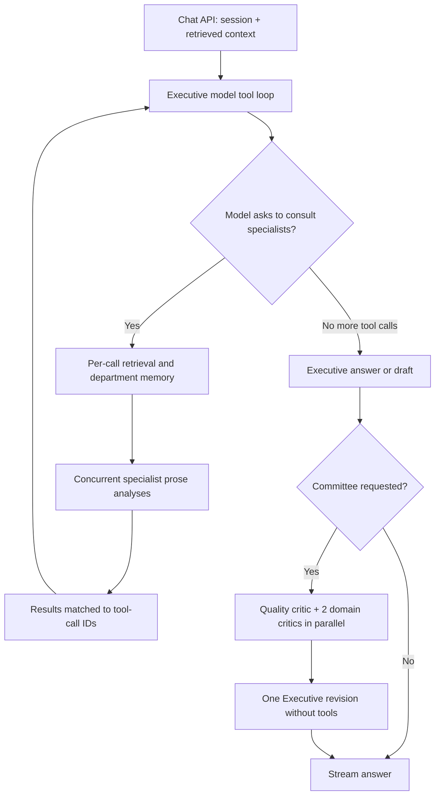

# OpenExecutive orchestration: source-backed research

Inspected commit `a59b4420291945c839d6d5be9c724568772d8b7c` (2026-10-23). This is static source inspection; no service or LLM-backed evaluation was run.

## Verified architecture

- **The chat route selects ordinary or committee execution explicitly.** It passes the same session, RAG, episodic, peer-memory and turn-source context into the chosen path. [chat.py L1463–1498](https://github.com/SenteLabsAI/OpenExecutive/blob/a59b4420291945c839d6d5be9c724568772d8b7c/packages/core/openexecutive/api/routes/chat.py#L1463-L1498)
- **The Executive is a model-directed tool-use loop**, defaulting to 15 iterations. It streams from the selected provider; parses requested tools; sends specialist requests to the router; appends tool results by ID; repeats. This is a custom Python async loop, not evidence of a LangGraph dependency. [executive.py L2180–2205](https://github.com/SenteLabsAI/OpenExecutive/blob/a59b4420291945c839d6d5be9c724568772d8b7c/packages/core/openexecutive/orchestrator/executive.py#L2180-L2205), [L2389–2444](https://github.com/SenteLabsAI/OpenExecutive/blob/a59b4420291945c839d6d5be9c724568772d8b7c/packages/core/openexecutive/orchestrator/executive.py#L2389-L2444), [L2610–2622](https://github.com/SenteLabsAI/OpenExecutive/blob/a59b4420291945c839d6d5be9c724568772d8b7c/packages/core/openexecutive/orchestrator/executive.py#L2610-L2622), [L3678–3688](https://github.com/SenteLabsAI/OpenExecutive/blob/a59b4420291945c839d6d5be9c724568772d8b7c/packages/core/openexecutive/orchestrator/executive.py#L3678-L3688)
- **There are nine domain specialists plus triage in the registry**: strategy, finance, HR, legal, operations, marketing, product, sales, board communications, triage. `consult_specialist` accepts a specialist key, query and optional conversation context. Its description asks the model to consult for judgment but skip routine lookups. [router.py L28–39](https://github.com/SenteLabsAI/OpenExecutive/blob/a59b4420291945c839d6d5be9c724568772d8b7c/packages/core/openexecutive/orchestrator/router.py#L28-L39), [L73–102](https://github.com/SenteLabsAI/OpenExecutive/blob/a59b4420291945c839d6d5be9c724568772d8b7c/packages/core/openexecutive/orchestrator/router.py#L73-L102)
- **Each specialist gets narrowly prepared context.** The router fetches domain-filtered knowledge and failure cases concurrently, then department memory; specialist calls run concurrently and return in original call order. One failed/empty specialist becomes an explicit unavailable result while other analyses survive. Cancellation propagates. [router.py L411–464](https://github.com/SenteLabsAI/OpenExecutive/blob/a59b4420291945c839d6d5be9c724568772d8b7c/packages/core/openexecutive/orchestrator/router.py#L411-L464), [L479–567](https://github.com/SenteLabsAI/OpenExecutive/blob/a59b4420291945c839d6d5be9c724568772d8b7c/packages/core/openexecutive/orchestrator/router.py#L479-L567)
- **Ordinary specialist analysis is one prose model call, not an autonomous code-execution agent.** `analyze()` assembles context tags and invokes `messages_create` without tools, returning text. A separate `analyze_with_tools()` API exists, but ordinary routing calls `analyze()`. [router.py L238–261](https://github.com/SenteLabsAI/OpenExecutive/blob/a59b4420291945c839d6d5be9c724568772d8b7c/packages/core/openexecutive/orchestrator/router.py#L238-L261), [base.py L114–196](https://github.com/SenteLabsAI/OpenExecutive/blob/a59b4420291945c839d6d5be9c724568772d8b7c/packages/core/openexecutive/agents/base.py#L114-L196), [base.py L214–239](https://github.com/SenteLabsAI/OpenExecutive/blob/a59b4420291945c839d6d5be9c724568772d8b7c/packages/core/openexecutive/agents/base.py#L214-L239)
- **Fan-out limiting is simple truncation of a requested batch.** The first configured number of calls run; excess calls receive explicit skipped results. A nonpositive setting uses registry size (currently ten). Despite comments describing a per-turn cap, the shown implementation partitions the current loop iteration's batch and does not maintain a cumulative consultation counter. [router.py L264–309](https://github.com/SenteLabsAI/OpenExecutive/blob/a59b4420291945c839d6d5be9c724568772d8b7c/packages/core/openexecutive/orchestrator/router.py#L264-L309), [executive.py L2733–2750](https://github.com/SenteLabsAI/OpenExecutive/blob/a59b4420291945c839d6d5be9c724568772d8b7c/packages/core/openexecutive/orchestrator/executive.py#L2733-L2750)
- **Committee review is bounded and optional:** one quality critic, two domain critics chosen from successfully consulted domains, with CSO/CFO fallbacks; the three critiques run concurrently. Then the Executive makes exactly one revision call without tools. This is not an iterative debate or majority vote. [committee.py L1–5](https://github.com/SenteLabsAI/OpenExecutive/blob/a59b4420291945c839d6d5be9c724568772d8b7c/packages/core/openexecutive/orchestrator/committee.py#L1-L5), [L38–95](https://github.com/SenteLabsAI/OpenExecutive/blob/a59b4420291945c839d6d5be9c724568772d8b7c/packages/core/openexecutive/orchestrator/committee.py#L38-L95), [executive.py L3018–3058](https://github.com/SenteLabsAI/OpenExecutive/blob/a59b4420291945c839d6d5be9c724568772d8b7c/packages/core/openexecutive/orchestrator/executive.py#L3018-L3058), [L1989–2007](https://github.com/SenteLabsAI/OpenExecutive/blob/a59b4420291945c839d6d5be9c724568772d8b7c/packages/core/openexecutive/orchestrator/executive.py#L1989-L2007)
- **Critiques have a small structured envelope**: reviewer, severity, critique, suggested edits. The model is asked for JSON, which is extracted from free text. Call and parsing failures become low-severity placeholder critiques. This is graceful degradation for advisory writing; it must not be confused with a passing code review. [committee_reviewers.py L58–70](https://github.com/SenteLabsAI/OpenExecutive/blob/a59b4420291945c839d6d5be9c724568772d8b7c/packages/core/openexecutive/orchestrator/committee_reviewers.py#L58-L70), [L79–166](https://github.com/SenteLabsAI/OpenExecutive/blob/a59b4420291945c839d6d5be9c724568772d8b7c/packages/core/openexecutive/orchestrator/committee_reviewers.py#L79-L166)
- **Triage primarily handles inbound business events, not a required pre-stage of chat routing.** Its dedicated method forces an `emit_alert_decision` tool response; on failure it returns a suppressed, persisted-only decision. [triage.py L209–281](https://github.com/SenteLabsAI/OpenExecutive/blob/a59b4420291945c839d6d5be9c724568772d8b7c/packages/core/openexecutive/agents/triage.py#L209-L281)
- **Dynamic workflows are ordered step interpreters, not a dependency DAG.** Step variants include specialist consult, approval gate, action and synthesis. A gate yields resume state and ends current execution; a synthesis step terminates with an artifact. Validation requires exactly one terminal synthesis. [dynamic.py L552–723](https://github.com/SenteLabsAI/OpenExecutive/blob/a59b4420291945c839d6d5be9c724568772d8b7c/packages/core/openexecutive/workflows/dynamic.py#L552-L723), [dynamic_models.py L393–418](https://github.com/SenteLabsAI/OpenExecutive/blob/a59b4420291945c839d6d5be9c724568772d8b7c/packages/core/openexecutive/workflows/dynamic_models.py#L393-L418)
- **Caching separates stable instructions from changing context.** Current implementation merges persona and knowledge index into one 1-hour system block, with an optional profile/org block; RAG belongs in the user turn. [cache_manager.py L32–53](https://github.com/SenteLabsAI/OpenExecutive/blob/a59b4420291945c839d6d5be9c724568772d8b7c/packages/core/openexecutive/prompts/cache_manager.py#L32-L53), [L166–206](https://github.com/SenteLabsAI/OpenExecutive/blob/a59b4420291945c839d6d5be9c724568772d8b7c/packages/core/openexecutive/prompts/cache_manager.py#L166-L206)

## Documentation versus code

The architecture document is useful as an overview but should not be copied literally. It describes direct Anthropic calls and three cached system blocks; the current registry routes configured local models to an OpenAI-compatible backend, Claude to Anthropic or OpenRouter, and other models to OpenRouter. Current caching uses at most two system blocks. Some code comments still refer to OpenRouter arriving in a future commit despite its implementation being present. Prefer executable paths over prose. [docs/architecture.md](https://github.com/SenteLabsAI/OpenExecutive/blob/a59b4420291945c839d6d5be9c724568772d8b7c/docs/architecture.md), [registry.py L451–488](https://github.com/SenteLabsAI/OpenExecutive/blob/a59b4420291945c839d6d5be9c724568772d8b7c/packages/core/openexecutive/providers/registry.py#L451-L488), [base.py L191–196](https://github.com/SenteLabsAI/OpenExecutive/blob/a59b4420291945c839d6d5be9c724568772d8b7c/packages/core/openexecutive/agents/base.py#L191-L196), [cache_manager.py L48–53](https://github.com/SenteLabsAI/OpenExecutive/blob/a59b4420291945c839d6d5be9c724568772d8b7c/packages/core/openexecutive/prompts/cache_manager.py#L48-L53)

## Three patterns worth adapting

These are design recommendations, not features already present in OpenExecutive.

1. **A coordinator with bounded parallel specialist work.** Use explicit review domains or independent review lenses, a stable request/result contract, per-review budgets, failure isolation and traceable tool-call IDs. Reuse the routing concept; prefer a deterministic review plan for mandatory checks.
2. **Independent critique followed by consolidation.** Have a verifier challenge candidate findings before a final deduplication and reporting pass. Preserve evidence and reviewer disagreement rather than asking an Executive persona to smooth everything into one persuasive answer.
3. **Context preparation and observability as shared infrastructure.** Build a reproducible context bundle once per base/head revision; retrieve narrowly for each reviewer; record which files, lines, tests, model and prompt revision produced each claim. Separate stable repository policy from mutable PR content, mirroring the cache separation.

## Three mismatches to resolve before implementation

1. **Prose advice versus evidence-bearing findings.** The existing specialist and critique contracts lack commit SHA, path/line range, trigger, impact, evidence, confidence and verification status. Add a strict schema plus deterministic location validation; prose synthesis alone cannot support reliable PR annotations.
2. **Advisory failure handling versus merge authority.** An unavailable reviewer or unparsable critique currently degrades to partial analysis/low severity. A code review agent must expose incomplete coverage. If it ever gates merging, infrastructure/model failures must be distinct from “no problems found.”
3. **Conversation context versus reproducible repository analysis.** Business RAG, episodic memory and sequential executive workflows do not supply immutable repository snapshots, diff parsing, symbol/caller context, isolated tests, webhook idempotency or stale-head checks. These are new modules, and their scope depends on whether the product is local, CI, GitHub App or hosted service.

## Useful first interview decisions

- Is version one an advisory review assistant, a blocking merge gate, or an agent that also proposes fixes?
- Is the target workflow local/CLI or automatic PR review, and who is the first user?
- Is reuse architectural inspiration with a new review core, or a fork of the full application?
- Which value comes first: correctness/security defects, spec compliance, maintainability, or a broad review?

The later questions (publication permissions, safe test execution, latency/cost ceilings, tenancy, exact stack, reviewer count, evaluation corpus) depend on those answers.
